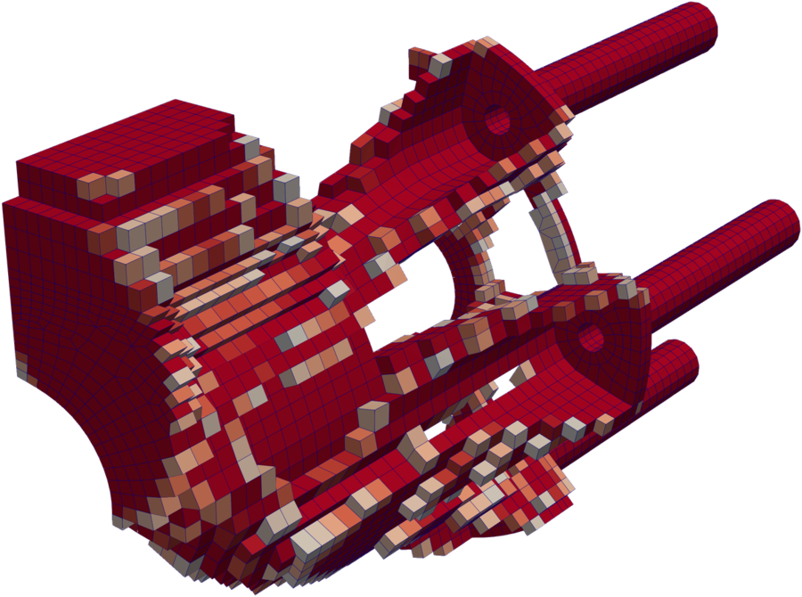
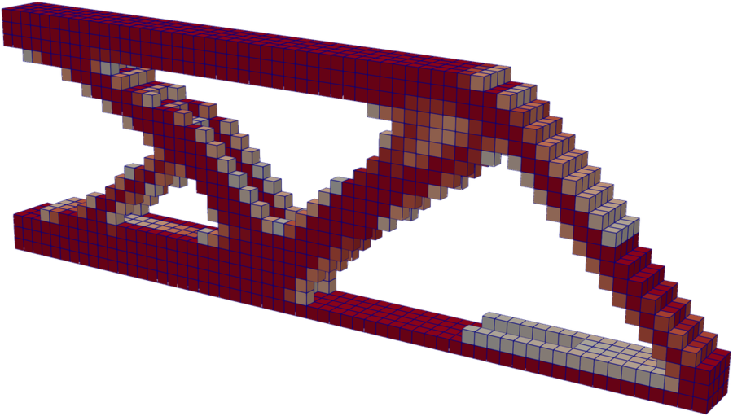
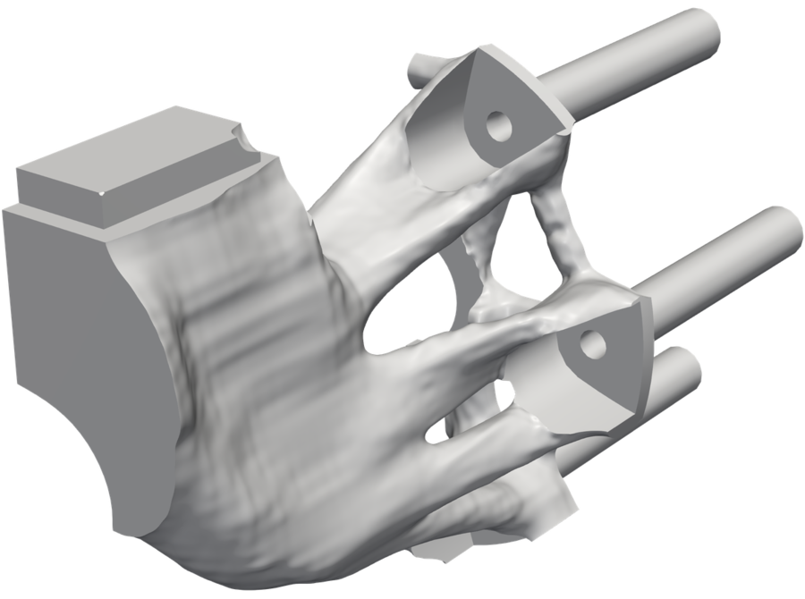
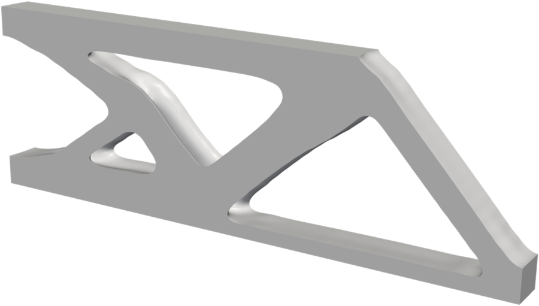
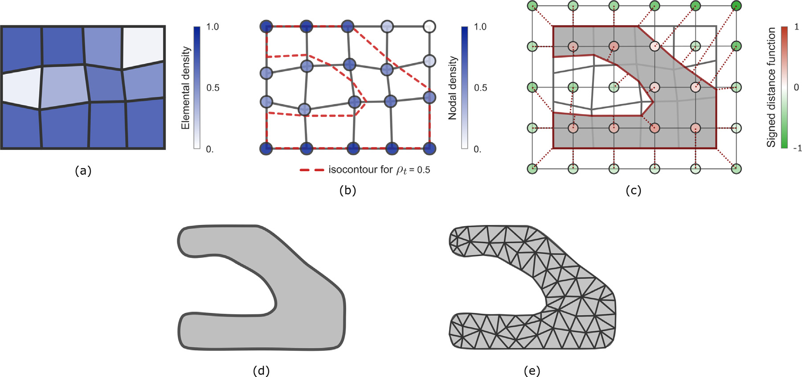

# rho2sdf.jl

**Smooth, volume-preserving geometry from SIMP topology optimization.**

[](https://doi.org/10.1016/j.advengsoft.2025.104071)

<table>
  <thead>
    <tr>
      <th width="50%">SIMP result (ρ ≥ 0.5)</th>
      <th width="50%">rho2sdf.jl</th>
    </tr>
  </thead>
  <tbody>
    <tr>
      <td>
        
        
      </td>
      <td>
        
        
      </td>
    </tr>
  </tbody>
</table>

Density-based topology optimization (SIMP) yields an element-wise density field that exhibits jagged boundaries due to
the underlying finite element discretization and regions of intermediate density without physical meaning.
rho2sdf.jl extracts a smooth geometry from this field: it constructs a signed distance function (SDF) of the density
isocontour and refines it with radial basis functions (RBFs) while preserving the volume of the optimized structure.
The extraction is purely geometric and requires no further optimization. The resulting boundary appears to originate
from a much finer discretization, while the optimization retains the computational efficiency of a coarse mesh.

This is the implementation of

> O. Ježek, J. Kopačka, M. Isoz, D. Gabriel, P. Maršálek, M. Šotola, R. Halama.
> *Smooth geometry extraction from SIMP topology optimization: Signed distance function approach with volume
> preservation.* Advances in Engineering Software 212 (2026) 104071.
> [doi:10.1016/j.advengsoft.2025.104071](https://doi.org/10.1016/j.advengsoft.2025.104071)

## How it works

<p align="center">
  
</p>

- **(a → b) Density isocontour.** The element densities are mapped to the nodes by a local least-squares fit.
  Interpolated by the element shape functions, they define the boundary as the isocontour ρ = ρ<sub>t</sub>.
- **(c) Signed distance function.** The distance of every node of a regular Cartesian grid to this boundary is
  computed exactly, its sign follows from the interpolated density. The grid is independent of the finite element mesh.
- **(d) Smoothing with volume preservation.** Gaussian radial basis functions turn the grid values into a smooth
  field. A uniform shift of the field restores the volume of the SIMP design, and a clip by the design domain keeps
  the body inside it.
- **(e) Tetrahedral mesh.** The field is meshed directly by isosurface stuffing in
  [Implicit2TetMesh.jl](https://github.com/jezekon/Implicit2TetMesh.jl).

## Quick start

```julia
] add https://github.com/kopacja/rho2sdf.jl
```

```julia
using Rho2sdf

# X: node coordinates, IEN: 8-node hexahedra, rho: element densities of a SIMP result
rho2sdf("beam", X, IEN, rho; options = Rho2sdfOptions(sdf_grid_setup = :automatic))
```

The smooth field is saved to `Z_beam_RBF_*.jld2` for Implicit2TetMesh.jl, together with a VTI file for ParaView.
Examples: [`cantilever_beam.jl`](cantilever_beam.jl) and [`chapadlo_run.jl`](chapadlo_run.jl) (the gripper) with the
inputs in [`test/`](test). All options: `?Rho2sdfOptions`.

## Citation

```bibtex
@article{Jezek2026,
  title   = {Smooth geometry extraction from {SIMP} topology optimization: Signed distance function
             approach with volume preservation},
  author  = {Je{\v{z}}ek, Ond{\v{r}}ej and Kopa{\v{c}}ka, J{\'a}n and Isoz, Martin and Gabriel, Du{\v{s}}an
             and Mar{\v{s}}{\'a}lek, Pavel and {\v{S}}otola, Martin and Halama, Radim},
  journal = {Advances in Engineering Software},
  volume  = {212},
  pages   = {104071},
  year    = {2026},
  doi     = {10.1016/j.advengsoft.2025.104071}
}
```
